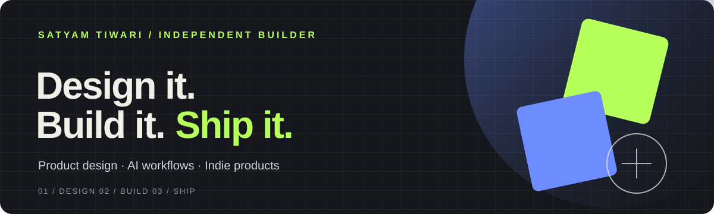

### Product Designer · Builder · Independent Maker

I design, prototype, and build thoughtful digital products — exploring the intersection of **product design, AI-powered workflows, and indie software**.

[Portfolio](https://besatyam.com) · [LinkedIn](https://www.linkedin.com/in/satyamtiwari27/) · [Substack](https://satyamtiwari2701.substack.com/) · [Figma](https://www.figma.com/@satyam_tiwari)

---

## 01 / What I'm exploring

- **Design:** Product thinking, interaction design, accessibility, and useful interface tools.
- **Build:** AI-assisted development, Claude Code skills, and design-to-code workflows.
- **Ship:** Small apps, open-source experiments, and products that solve real problems.

## 02 / Selected work

<table>
<tr>
<td width="50%" valign="top">

### [Design Direction Skill](https://github.com/Satyam2701/design-direction-skill)

A Claude Code skill for designers — turning vague ideas into a mood brief, concrete specification, and better feature thinking.

**Focus:** AI for design · Product thinking · Claude Code

</td>
<td width="50%" valign="top">

### [Aesthetic Widgets](https://github.com/Satyam2701/aesthetic-widgets)

A UI-focused project exploring considered visual design and interface implementation.

**Focus:** UI craft · Components · Interaction design

</td>
</tr>
<tr>
<td width="50%" valign="top">

### [Flowguard](https://github.com/Satyam2701/flowguard)

A product experiment in my growing collection of tools and build explorations.

**Focus:** Product experimentation · Software building

</td>
<td width="50%" valign="top">

### [Chroma Color Picker](https://github.com/Satyam2701/chroma-color-picker)

A small design utility exploring color selection and practical designer workflows.

**Focus:** Design tools · Color · Usability

</td>
</tr>
<tr>
<td width="50%" valign="top">

### [Spec Overlay](https://github.com/Satyam2701/spec-overlay)

An experiment in making design specifications and implementation workflows easier to work with.

**Focus:** Design engineering · Handoff workflows

</td>
<td width="50%" valign="top">

### [Boring Widget](https://apps.apple.com/gb/app/boring-widget/id6794598346)

A shipped iOS app and part of my exploration into building useful, focused indie products.

**Focus:** iOS · Product design · Indie making

</td>
</tr>
</table>

## 03 / GitHub stats

Stats are generated by third-party services and may be delayed, rate-limited, or unavailable. Language cards represent repository code composition, not a complete measure of skill.

## 04 / Tools & practice

**Design** — Product design · UX · UI systems · Accessibility · Prototyping

**Building** — Claude Code · AI-assisted workflows · SwiftUI / iOS · JavaScript / TypeScript

I learn by making: building useful things, documenting what I learn, and improving in public.

## 05 / Currently

- Improving tools and workflows for product designers.
- Exploring how AI can support better product thinking and design execution.
- Building small, thoughtful software experiences.

## 06 / Let's connect

Have an interesting product problem, an open-source idea, or a design-engineering collaboration in mind?

**[Visit my portfolio](https://besatyam.com)** · **[Connect on LinkedIn](https://www.linkedin.com/in/satyamtiwari27/)**

---

Designed with intent. Built with curiosity. Shipped in public.

